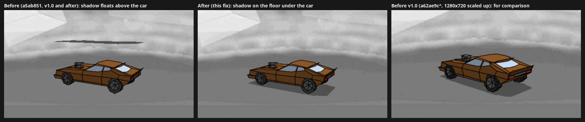

## Context

**How the car select draws its car.**
- `GameUi.carselect` sets the car select's camera on `Medium` (`x`, `y`, `z`, angles, and `ground = 570`, the floor's height below the camera), then draws the car inside `Medium.menuView()`.
- Since v1.0 (a62ae9c, "native-size UI") the menus are drawn at the size of the window instead of 1280x720 scaled up. `menuView` calls `setView`, which moves the picture's centre (`cx`, `cy`) to the middle of the menus' picture and moves the camera (`x`, `y`) with it. The car therefore keeps its own size in the middle of a picture of any size.
- `ContO.d` draws the car's shadow with `Plane.s`, at `py = Medium.ground`. Like `y`, the ground is measured from the camera.

**The bug.** `setView` moved `y` but not `ground`. In a menus' picture taller than 720, the car moved down to the middle, but the floor its shadow is drawn on stayed where it was in the 1280x720 picture. The result is a flat grey sliver floating above the car: 180 px too high at 1080, 360 px at 1440.

Races never showed it. `Medium.d` sets `ground = 250 - y` every frame, after the view is set, and races are verified at 1280x720, where `setView` moves nothing.

**Before and after**, hidden runs on the owner's PC (2560x1440 window), cropped around the car:

- `docs\reviews\2026-11-21-car-select-shadow-before.png`: a5ab851, the shadow above the car.
- `docs\reviews\2026-11-21-car-select-shadow-after.png`: this change, the shadow on the floor under the car.
- `docs\reviews\2026-11-21-car-select-shadow-v0.9-reference.png`: a62ae9c^, built in a worktree and run hidden at 1920x1080. That build drew 1280x720 and scaled it up, so its shadow was right. For the run only, its sound was silenced; nothing else was changed, and the worktree is gone.

## Goals / Non-Goals

**Goals:** The car select's shadow lies under the car at every menu size, as before v1.0. A check fails if it does not. Races and their golden frames do not change.

**Non-Goals:** Changing how the car select looks otherwise (camera, size, floor, lighting).

## Decisions

1. **`setView` moves the ground with the camera** (`ground -= cy - centreY`, the same amount as `y`).
   - Everything drawn through `menuView`, `paneView` or `showView` gets its floor where its camera is. That covers the car select (alone and in split screen) and the unlocked-car box.
   - *Alternative:* setting the ground again in `carselect` after `menuView`. Rejected: every caller of the views would have to know to do this, and split screen's panes would still be wrong.
2. **One method draws the car select's car** (`GameUi.drawSelectCar`). The car select and the check both use it, so the check tests what the player sees.
3. **The check runs in the verifier, after the races** (`RaceSession.Verifier.checkCarSelect`, through `Host.carSelect`).
   - Drawing the car moves `Medium`'s camera, which a race reads. `SessionHost.carSelect` therefore puts the camera, the ground, `crs`, the menus' size and the car's pose back afterwards, and the check runs after the last race.
   - Three cars (0, 6 and 12: small, mid-size and large) are drawn at 1280x720 and compared with golden pictures in `test\golden\carselect\`. Then each is drawn at 1920x1080, 2560x1080, 2560x1440 and 1280x960, and must be the 1280x720 picture in the middle of the larger one (`GoldenFrames.sameAs`).
   - The car is drawn twice into each picture. `ContO` sorts its faces from the previous draw's depths, so the first draw after a pose change can put a hidden face in front.
4. **Edge pixels may differ a little at other sizes.**
   - Moved, a corner is worked out in floats of another precision: `Utility.rot` adds the picture's centre, 640 at 1280 wide but 960 or 1280 at the others. Where an edge crosses a pixel, it covers a little more or less of it.
   - Measured: 7-28 of 921,600 pixels differ, all on edges, by up to 55 per channel. 1280x960 has the same centre width and matches exactly.
   - Rule: a pixel may differ only where both pictures have an edge (its 3x3 neighbourhood is not one colour), and no more than 1 pixel in 1,000 may differ that way.
   - A moved shadow fails it: inside a surface of one colour there is no edge, and a shadow left where the floor was lies on plain floor.
   - *Alternatives:* a per-channel tolerance (rejected: the edge pixels differ by up to 55, which would also hide real changes); golden pictures at every size (rejected: it cannot show that the larger pictures match the 1280x720 one, which is the bug).

## Proof

| Build | 20 races | Car select at 1280x720 | Car select at the 4 other sizes, 3 cars |
|---|---|---|---|
| Without the `ground` line | 20 matched | same | **12 of 12 CHANGED**, 3,640-9,691 pixels |
| With it | 20 matched | same | 12 of 12 same (0-28 edge pixels) |

`test\verify-races.ps1`: golden frames 95 same, 0 changed. All 80 race frames are unchanged, and the 3 car select golden pictures and 12 size checks are new.

## Risks / Trade-offs

- **Other 3D in menus also gets its floor moved.** The unlocked-car box is drawn through the same views. Only its shadow can change, and it is now under its car as well.
- **Races, the stage select and split screen's panes look the same.**
  - They call `Medium.d` inside the view, which sets the ground from the moved camera. Within the view the ground is therefore the same as before.
  - Only its value after the view closes changes: it is now the game view's again instead of staying moved.
  - Nothing in the race reads it. Outside drawing, `Medium.ground` is read only while a stage loads (after it is set to 250) and for the 3D sound's copy of the stage, made then too.
- **The edge rule could hide a change made only of edge pixels.** The cap of 1 in 1,000 limits it: 921 pixels at 1280x720, where the car's outline alone is several thousand.
